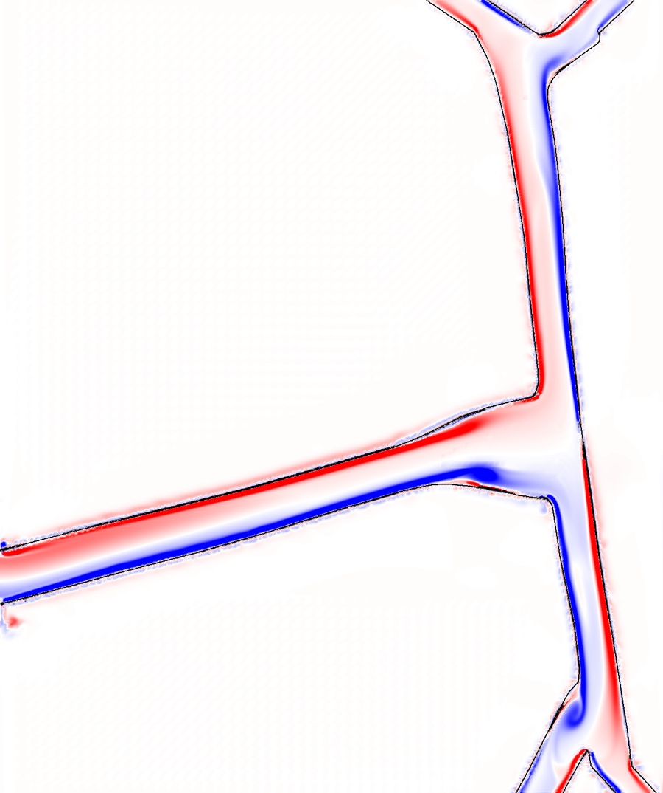
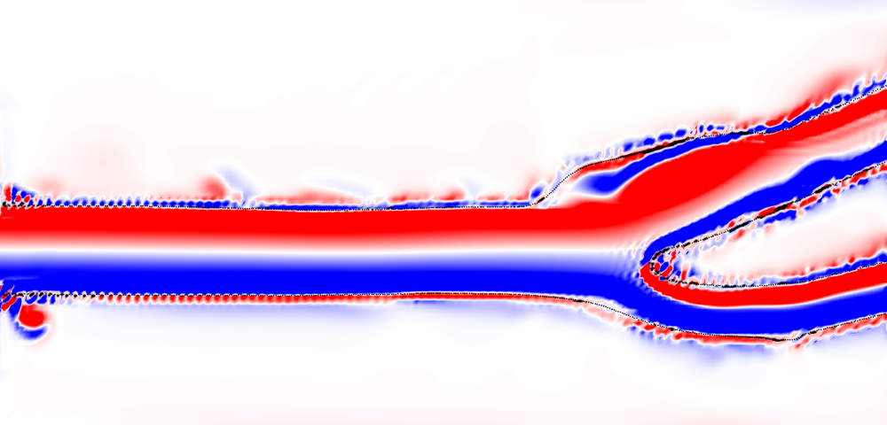

# IB/13 Carotid artery, pulsatile flow: a horse and a human

Blood pulses through the carotid artery of a horse, and, for comparison, through a human carotid bifurcation. Both vessels are real geometries at their own size: the horse case is the silhouette of an equine carotid where the common carotid meets the vessel that runs up to the internal carotid and occipital artery and down to the external carotid; the human case is the lumen outline of a carotid bifurcation in its bifurcation plane. The walls are rows of target points; the inflow is a parabola across the common carotid whose mean follows a pulse with the animal's heart rate and ejection timing; the branches leave through open faces of the box. This is the horse example promised in the October 2026 release posts.

| | |
|---|---|
| Method | Immersed boundary (IB): target points |
| Dimension | 2D |
| Chapters | 7 (boundary conditions), 6 (structure files), 8a (choosing the target stiffness), 11 (forces), 25 (where the pulsatile inflow and the open outflow come from) |
| Run time | human: 3.5 minutes for two cycles on 4 cores; horse: 44 minutes (IBAMR 0.19.0 on a laptop) |
| Tested with | IBAMR 0.19.0 (autoibamr; GCC 13.3, Open MPI 4.1.6, Ubuntu 24.04) |
| Upstream relative | `examples/IB/explicit/ex2` in IBAMR (a body held by target points in a stream); this series' IB/02 is the same program with straight walls |

## Files

| File | What it is |
|---|---|
| `main.cpp` | The IBAMR program; the same program as IB/01 and IB/02 |
| `input2d.horse`, `input2d.human` | The two cases: physical, grid, solver and output settings and the boundary conditions; written by `make_input.py` |
| `horse.vertex`, `horse.target`, `horse.spring` | 4033 wall points of the horse case, their target stiffness, and the 4028 springs between neighbours along each wall |
| `human.vertex`, `human.target`, `human.spring` | 1045 wall points of the human case, with their targets and 1042 springs |
| `vessel_walls.py` | Cuts an outline into walls and writes the three files: `python3 vessel_walls.py --case horse --DT 3e-5` (or `--case human --DT 5e-5`); `--fine 2` for twice the resolution |
| `make_input.py` | Writes `input2d.<case>` from `<case>_geometry.txt`, so the box, grid and inlet band match the points |
| `horse-outline.csv` | The silhouette of the equine carotid model on its principal plane, in mm (`tools/project_outline.py` in the working tree) |
| `carotid2-outline.csv` | The lumen and outer-wall outlines of the human model in its bifurcation plane, in mm (`tools/carotid_outline.py`) |
| `<case>_geometry.txt`, `<case>-walls.png` | The numbers the generator prints, and a picture of the walls with the inlet marked |
| `CMakeLists.txt` | Build instructions for CMake |
| `job.slurm` | Batch script for Puma (the horse case at twice the resolution) |

## The two vessels

- **Horse.** A surface model of an equine carotid artery from Laura Miller's research files (a lofted model 36 cm long; the 3D model itself is not published yet). Its branches do not lie in one plane, so the 2D vessel is the model's *silhouette* on the plane of its two largest principal axes (`tools/project_outline.py`: rasterize, blur a little, trace the half level), cut 12 cm into the common carotid and just beyond the two branchings. In the plane the common carotid is 11.5 mm wide, the upward vessel 13 mm and 10 mm at its two outlets, the downward one 10 mm and 9 mm. Box 14.25 cm by 17 cm; inflow on the left face, the four outlets on the top and bottom faces.
- **Human.** A carotid bifurcation from the NIH 3D model repository (`Carotid2.STL`), cut by the plane of its two largest principal axes (`tools/carotid_outline.py`); the inner of the two concentric curves is the lumen. Common carotid 6.3 mm wide, internal carotid with its bulb 5.3 mm at the outlet, external carotid 3.7 mm. Box 6.25 cm by 3 cm; inflow on the left face, both outlets on the right face.

Both are used at their own size. The generator keeps the model's millimetres; `--case human` only flips x so that the flow runs to the right.

## The physics

- **Units:** cm, g, s. Blood: density 1.05 g/cm³, viscosity 0.035 g/(cm s).
- **Walls:** two points per fine cell (half a cell apart) along each wall. Every point is a target point with stiffness 0.2 ρ DX²/DT² (chapter 8a's rule for a stiffness the time step can carry), and neighbouring points along a wall are joined by springs at half that stiffness, rest length their spacing, so that a row of points cannot stretch, bunch, or open a gap that fluid leaks through. The points stop half a spacing inside the box faces (a point exactly on a face is counted by two patches and IBAMR stops at start-up). The vessel ends are extended straight along each vessel's axis to the face, so the inflow and outflow conditions sit on the faces.
- **Inflow (left face, across the lumen only):** u(y, t) = 6 U(t) (y − y₀)(y₁ − y)/(y₁ − y₀)², a parabola whose mean is the pulse U(t) = U_dia + (U_sys − U_dia) w(t), w(t) = (t/t_p)ᵏ exp(k(1 − t/t_p)) within each cycle: a pulse that peaks at t_p and has fallen to 0.15 of its height at the end of ejection, with k = 1.28. Ramped up over the first 0.2 s.
  - Horse: 36 beats per minute, t_p = 0.122 s, ejection 0.467 s (the resting-Thoroughbred aortic values of Blissitt & Bonagura 1995, Table 2, as used in the horse aorta study), U_dia = 10, U_sys = 50 cm/s: cycle mean 17 cm/s. The carotid keeps forward flow in diastole, which is what U_dia provides; the shape is the aortic one.
  - Human: 70 beats per minute, t_p = 0.10 s, U_dia = 20, U_sys = 70 cm/s: cycle mean 29 cm/s.
- **Outflow:** zero traction for both velocity components over the whole of each outflow face (a = 0, b = 1), zero velocity on the closed faces; the box pressure is not normalized. Two other choices were tried and are worth knowing: opening only the outlet bands (no-slip on the rest of the face, as in IBAMR's IBFE ex8) puts a no-slip strip exactly where the leaky point wall meets the face, and the shear there blew up the human case at its second systolic peak; pinning only the tangential velocity on the open faces made the horse's branches, which meet their faces at 30 and 45 degrees, blow up at t = 0.37 s whatever the time step. The fluid outside the vessels is a dead space that barely moves.
- **Numbers:** horse, Reynolds number U D ρ/μ about 590 at the cycle mean and 1700 at the peak, Womersley number 6.1; human, 540 and 1300, Womersley 4.7.
- **Grid:** two levels of refinement ratio 4; the fine level is 0.03125 cm in both cases (37 cells across the horse's common carotid, 20 across the human's). Time steps 3 × 10⁻⁵ s for the horse and 5 × 10⁻⁵ s for the human: at twice these the second systolic peak sits at the CFL limit (the human's peak speed is 110 cm/s), and the springs add to the stiffness the step must carry.

## Running it

```bash
cmake -S . -B build -DCMAKE_BUILD_TYPE=Release
cmake --build build -j 4
mpirun -np 4 ./build/main2d input2d.human      # 3.5 minutes
mpirun -np 4 ./build/main2d input2d.horse      # 44 minutes
```

Two cycles each, 50 VisIt frames per cycle in `viz_IB2d/`, 50 `X.*` files per cycle in `hier_data_IB2d/`. To change a geometry cut, a stiffness or the resolution, rerun the generator and the input writer, in that order: `python3 vessel_walls.py --case horse --DT 3e-5 --fine 2 && python3 make_input.py horse` (the generator sizes the stiffnesses for the step you give it; `make_input.py` holds the step itself).

## What you should see



Horse, vorticity (red counter-clockwise, blue clockwise, ±300 /s) at the systolic peak of the second cycle (t = 1.79 s): the common carotid's stream crosses the junction, meets the far wall and splits up and down; the flow separates on the downstream corner of the junction and sheds vortices into the lower vessel, which carries them to the fork; the two upper and two lower branches take the flow out through the top and bottom faces. At the end of diastole (`horse-flow-diastole.png`, t = 3.3 s) the lower vessel still holds the vortices the peak left behind.



Human, the same at its systolic peak: the parabolic profile, the stagnation point on the flow divider, and the separation in the bulb, which grows through diastole.

In VisIt: open `viz_IB2d/dumps.visit`, Pseudocolor of `Omega` with fixed limits; open `viz_IB2d/lag_data.visit` and add a Mesh plot of `horse_vertices` or `human_vertices` for the walls (chapter 28). `wsl/final/visit_ib13.sh` in the working tree made the pictures.

## Measured results (IBAMR 0.19.0, 4 cores)

| | horse | human |
|---|---|---|
| Steps (two cycles) | 111 112 | 34 189 |
| Wall time | 2639 s | 207 s |
| Peak speed in the box | 81 cm/s | 111 cm/s |
| Vorticity extremes at the systolic peak | −1640 to +1920 /s | −3270 to +3470 /s |
| Time step | 3 × 10⁻⁵ s, never reduced | 5 × 10⁻⁵ s, never reduced |
| Frames | 102 | 102 |

## Things to try

- **The horse's heartbeat.** 36 beats per minute is a resting horse; try 2 Hz (a gallop) with the same pulse shape and watch the Womersley number go from 6 to 11.
- **Where the flow goes.** Integrate the normal velocity across each outlet band (VisIt Lineout, or `hier_data_IB2d` with `examples/analysis/hier_data.py`) and plot the split between the branches over a cycle.
- **A stiffer wall.** Double the stiffnesses (`--kappa`, `--kappa_spring`) and halve the time step; chapter 8a's rule says both at once. Then take the springs away (an empty `.spring` file) and look for leakage along the walls.
- **Two ways to fail.** Set `BANDS = True` in `make_input.py`, or give the outflow faces a zero tangential velocity (a = 1 for the tangential component), and watch where and when `Time step size change encountered` arrives (chapter 25, the time-step slide).
- **Twice the resolution.** `--fine 2` on Puma: `sbatch job.slurm`.

## History

Planned 2026-10-13 as the horse example promised in the release posts; built 2026-10-15. The first version was the human geometry scaled up to a 1 cm vessel with a sine pulse; it became two cases at their real sizes with the equine pulse from the horse aorta study the same day, and got its wall springs and open faces the same afternoon. The equine 3D model stays private for now, hence the silhouette.
